<p align="center">
  <a href="https://trevorbilt.com">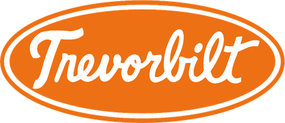</a>
</p>

<h1 align="center">Animal Crossing VR for Apple Vision Pro</h1>

<p align="center"><b>Your town, life size.</b></p>

<p align="center">
  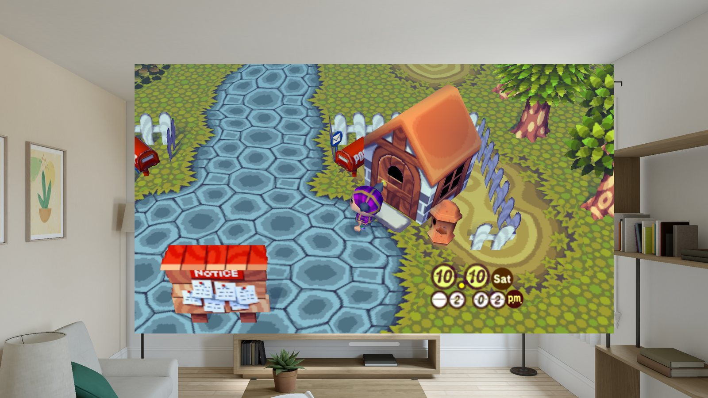
  <br><sub>The Window view on a sunny afternoon, in the visionOS Simulator's living room.</sub>
</p>

*Animal Crossing* (GameCube, 2002) running natively on Apple Vision Pro, in six degrees of
freedom. Walk your own town at life size, look up at the fruit in the trees, swing the net with
your own arm, or keep the town in a window beside your other apps. No PC, no streaming: just the
headset.

Animal Crossing VR is [Trevorbilt](https://trevorbilt.com)'s native visionOS port, built on
LiquidAzir's [animal-crossing-vr](https://github.com/LiquidAzir/animal-crossing-vr) mod, which
builds on ACreTeam's [decompilation](https://github.com/ACreTeam/ac-decomp), flyngmt's
[PC port](https://github.com/flyngmt/ACGC-PC-Port) and zwaetschge's 64-bit
[Android port](https://github.com/zwaetschge/ACGC-Android-Port). You bring the game, you build the
app, your villagers do the rest.

> [!IMPORTANT]
> There are no game files and no app download here. You need your own Animal Crossing disc
> (GameCube, USA) and a Mac to build with. Animal Crossing VR is a fan project. It isn't
> affiliated with or endorsed by Nintendo.

## What you get

- **Three ways to play**, picked in the launcher:
  - **Full**: your town all around you, in first person and at life size. Menus, your pockets,
    loading screens and fades to black can float in your room instead of a black void.
  - **Progressive**: a portal into your town that the Digital Crown widens and narrows.
  - **Window**: the GameCube game with its own camera, in a window beside your other apps. The
    game's 3D scene is rebuilt behind the glass every frame, so the houses, trees and cliffs have
    real depth when you look from the side. The HUD and the dialogue sit on the glass.
- **Your tools follow your hand.** The net, axe, shovel and fishing rod sit in your hand, and a swing
  uses them. Right-handed by default; left-handed players pick **Tool hand: Left**.
- **Play it your way.** PS VR2 Sense controllers, your bare hands (Full and Progressive), or a
  DualSense, Xbox or other gamepad.
- **Easy on the stomach.** Smooth or snap turning, and a gentle vignette while the game moves you.
  When the game takes over the camera (the train ride into town, for one), you stay put and look
  around.
- **Sharper than a GameCube ever was.** SMAA or FXAA anti-aliasing, and render resolution up to 150%.
- **Polite to your living room.** The game pauses when you take the headset off, and if you wander
  too far from where you started, the town fades into your room before you meet the coffee table.

<p align="center">
  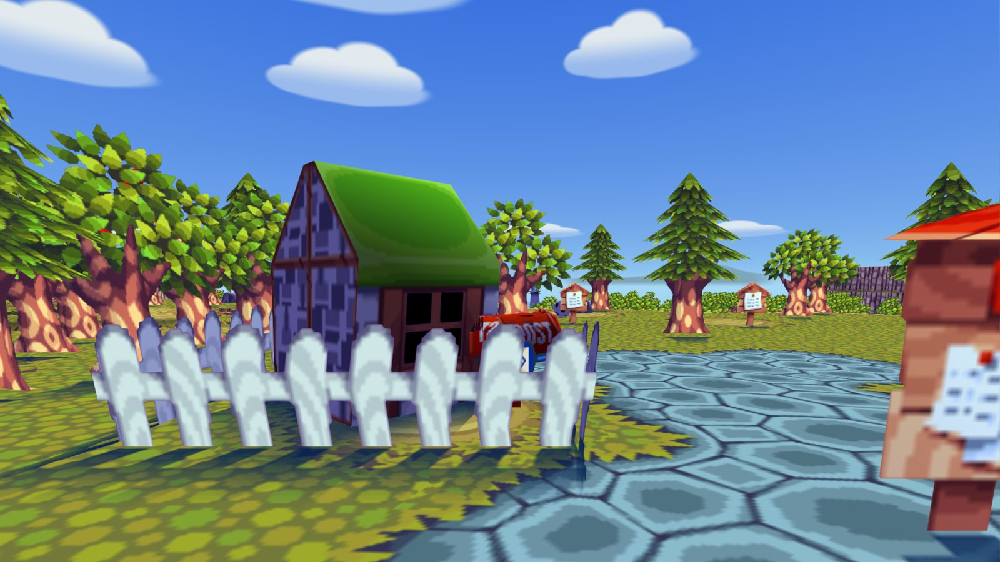
  <br><sub>Full immersion, in first person among the town's houses (the Simulator shows one eye's view).</sub>
</p>

<p align="center">
  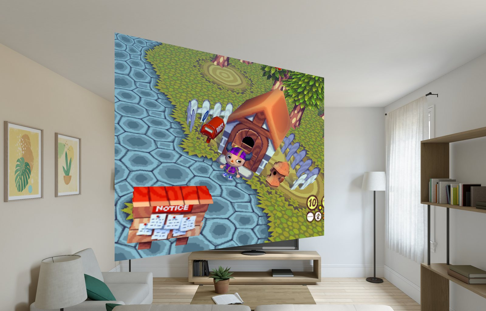
  <br><sub>The Window view from off to one side (Simulator again). That's real depth back there, not a picture.</sub>
</p>

## What you'll need

- **A headset:** Apple Vision Pro with visionOS 26 or later. It's tested on visionOS 27.
- **A Mac** with Apple silicon and Xcode at `/Applications/Xcode.app` (a path with a space in it
  trips up CMake), with its visionOS platform installed. Built and tested with Xcode 27 on macOS 27.
- **Some tools:** [Homebrew](https://brew.sh), then:

  ```bash
  brew install cmake ninja xcodegen
  ```

- **An Apple Account**, signed in to Xcode (Xcode › Settings › Accounts). The app asks for the
  increased memory limit; it's been built with a paid developer team, and whether a free account can
  sign it is untested.
- **The game:** your own Animal Crossing disc image, from a disc you own.
- **Patience:** about 2 GB of free disk, and 10 to 30 minutes for the first build (11 on an M4 Mac:
  it compiles the whole game once; later builds take minutes).

First time running your own app on a Vision Pro? Pair it with Xcode (Window › Devices and
Simulators) and turn on [Developer Mode](https://developer.apple.com/documentation/xcode/enabling-developer-mode-on-a-device)
on the headset. Apple's [guide to running on a device](https://developer.apple.com/documentation/xcode/running-your-app-on-simulated-or-physical-devices)
walks through both.

## Build it

1. **Get the code.**

   ```bash
   git clone https://github.com/edgytoast/animalcrossing-visionos.git
   cd animalcrossing-visionos
   ```

2. **Build and install.** With the headset awake, unlocked and paired:

   ```bash
   visionos/scripts/build-visionos.sh --team YOURTEAMID --install
   ```

   Your team ID is the 10-character ID shown for your team in Xcode › Settings › Accounts. The
   script builds SDL 2 once, then the game, then the app, and installs it. With a free Apple
   Account, the headset won't open the app until you trust it: Settings › General › VPN & Device
   Management.

The full install guide, including everything the build does on your Mac, is
[AVP-INSTALL.md](AVP-INSTALL.md).

Fancy the visionOS Simulator instead? `visionos/scripts/build-visionos.sh --simulator` builds it
unsigned, and [DEVELOPING.md](docs/DEVELOPING.md) has how to install it and get your disc in. It's
great for poking around, but terrible at judging looks: its GPU isn't the headset's.

## Bring your game

Animal Crossing VR plays your own disc image of the USA release, **GAFE01, revision 0**, as `.iso`,
`.gcm`, `.ciso` or an NKit `.iso`. [Dolphin's guide](https://wiki.dolphin-emu.org/index.php?title=Ripping_Games)
explains how to dump your disc; Dolphin's game list shows the game ID. Any of these get it onto the
headset:

- **AirDrop** it to your Vision Pro and choose **Animal Crossing VR** to open it with.
- **From Files:** put it anywhere Files can reach, then tap **Import** in the app.
- **By hand:** copy it into the app's own folder in Files (On My Apple Vision Pro › Animal
  Crossing VR).

The launcher checks the disc and tells you if it's another region or game. Then tap **Play**.

## Play

Before you press **Play**, the launcher asks how you'd like to play: **Full**, **Progressive** or
**Window**, plus **Show my room around menus** (Full only), with **Turning**, the **Comfort
vignette** and **Foveated rendering** under **Advanced**. The launcher has four tabs: **Play** covers
the above. **Controls** shows a drawing of whatever you're holding (Sense controllers, a
DualSense-style or Xbox-style pad, or your hands), labelling every button and gesture. **Ports**
browses the [AVP Ports Index](https://github.com/edgytoast/avp-ports-index). **About** has the
credits, licences and an update check.

**Saving works the way it always did:** talk to the gyroid beside your house. In Full or
Progressive, press the Digital Crown to pause: the game holds where you are, and the launcher offers
**Resume** or **Quit** (if it doesn't appear, open the app from Home). In Window, close the window to
quit. Quit without saving and Mr. Resetti will have words with you next time, just like on the
GameCube.

**Sense controllers** in Full and Progressive:

| Control | Does |
|---|---|
| Left stick | Walk (click: pockets) |
| Right stick | Turn (click: Z) |
| Right trigger or Cross, or a swing | Talk, pick up, use |
| Left trigger or Circle | Run, cancel |
| Square | Map |
| Triangle or Create | Pockets |
| Left grip + left stick | Switch tools |
| Right grip | Run |
| Square + Triangle | Recenter |
| Left grip + Triangle | First person, or the game's own camera |
| Options + right stick click | The VR settings |

**Bare hands** play in Full and Progressive (a Sense controller takes over the hand holding it):

| | | |
|---|---|---|
| 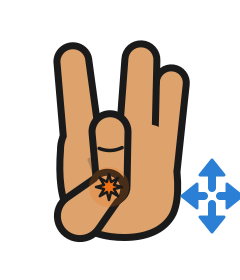 | **Walk** | Pinch and hold your left thumb and middle finger, then move your hand like a joystick. |
| 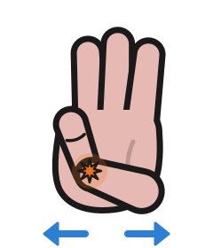 | **Turn** | Pinch and hold your right thumb and little finger, then move your hand sideways. Or just turn your body. |
| 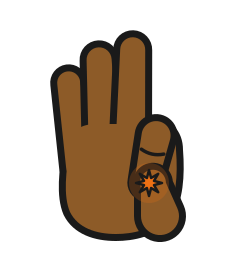 | **Talk, pick up, use** | Pinch your right thumb and index finger. |
| 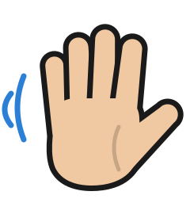 | **Use your tool** | Swing your hand while you hold a net, axe, shovel or rod (your left, with Tool hand: Left). |
| 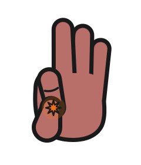 | **Run, cancel** | Pinch your left thumb and index finger. |
| 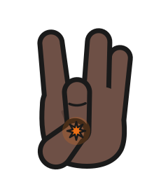 | **Map** | Tap your left thumb and middle finger together. |
| 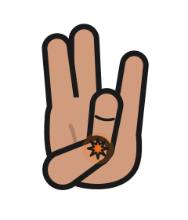 | **Pockets** | Pinch your left thumb and ring finger. |
| 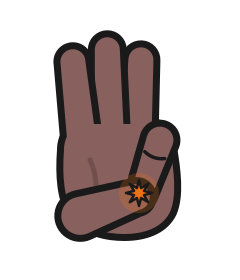 | **Menu** | Pinch your left thumb and little finger. |

**The Window view** plays like the original game, so it needs a controller: a gamepad, or both
Sense controllers held as one. visionOS gives apps no hand tracking outside Full and Progressive.
Look at the game window to give it your controller, since visionOS hands a controller to whichever
window you're looking at.

| Does | Gamepad | Sense controllers |
|---|---|---|
| Walk | Left stick | Left stick |
| Camera | Right stick | Right stick |
| Talk, pick up, use | A | Cross |
| Run, cancel | B, or hold either trigger | Circle, or hold either trigger |
| Map | X | Square |
| Pockets | Y or Menu | Triangle or Options |
| Switch tools | D-pad | Left grip + left stick |
| Light switch (indoors) | Right shoulder | Right grip |

A gamepad also plays in Full and Progressive: the original game's buttons, while you look around
with your head.

The game's own settings open from its pause menu. In Full and Progressive, **Options and a right
stick click** open the port's VR settings: **Tool hand** (right or left), hand visuals, turning,
motion swings, **Anti-aliasing** (Off, FXAA or SMAA) and **Render scale** (50 to 150%, from the next
Play).

## Update

Get the new code, then build and install again. If you came from the AVP Ports Index, run
`git fetch`, then `git checkout` the commit Animal Crossing VR's page there lists now (that's the
code it scanned; `git pull` doesn't work on it). If you cloned `main`:

```bash
git pull
visionos/scripts/build-visionos.sh --team YOURTEAMID --install
```

Your disc and saves stay on the headset. The app's About tab says when a newer version is out.

## If something goes sideways

- **CMake can't find Xcode.** Xcode must be at `/Applications/Xcode.app`, not a path with a space.
- **Signing fails on the memory entitlement.** Keep the team suffix on the bundle ID (the default,
  `dev.acvr.vision.YOURTEAMID`): a bare ID may already belong to another team.
- **The install hangs.** Wake and unlock the headset, then run the build command again.
- **The app won't open after a week.** Apps signed with a free account expire after 7 days. Build
  and install again; your disc and saves stay put.
- **The Window view ignores your controller.** Look at it. See above.
- **The launcher says the disc isn't right.** It plays the USA disc (GAFE01), revision 0, only.
  Dolphin's game list shows a disc's ID and revision.
- **Anything else.** The app's log lines start with `[ACVR]`. Run it from Xcode and the console
  tells you what happened.

## How it works

The game is the GameCube decompilation with the PC port's layer, compiled for visionOS as a
framework that a SwiftUI app runs on its own thread. The PC port's GX-to-OpenGL renderer draws
through a small OpenGL-on-Metal layer written for this port. LiquidAzir's VR mod applies your head
pose to the game's camera, puts the 2D screens on a panel, keeps the whole town loaded and fills in
the backs of buildings. On Vision Pro both eyes are drawn in one pass, each world draw instanced
into the left and right halves of one image. That image goes to an OpenXR provider for visionOS
(from WiiCompiled Vision, by way of Twilight Princess VR), built on CompositorServices and ARKit,
in a full, mixed or progressive immersive space.

The Window view is the odd one out: visionOS gives apps no head tracking there, so each 3D draw is
captured as the game makes it, its material reduced to what RealityKit can render, and the scene
rebuilt every frame behind a portal, where RealityKit renders it from your real eyes. The details,
the test hooks and how to work on it are in [docs/DEVELOPING.md](docs/DEVELOPING.md).

### What's in this repository

| Path | What |
| --- | --- |
| `visionos/` | The visionOS app (SwiftUI, the RealityKit window, the launcher), the host that runs the game, its build scripts, the vendored OpenXR provider and TrevorbiltKit |
| `src/`, `include/` | The game: ACreTeam's decompiled Animal Crossing, with the PC port's and the VR mod's hooks |
| `pc/` | The PC port's layer: GX on OpenGL, saves, input, the VR mod (`pc/src/pc_vr.cpp`), the OpenGL-on-Metal layer and the Window view's capture |
| `docs/` | How to work on the port, the PC port's, the Android port's and the VR mod's notes, and the pictures on this page |
| `app/` | The Android app this port's 64-bit base came from (the visionOS build doesn't use it) |

### How it was built

Built by Trevorbilt with Claude Code as an AI pair programmer; every commit is co-authored. Each
feature was checked in the visionOS Simulator with scripted play (a new game played through to a
save at the gyroid, the Crown pause, scripted hands and controllers), window frames were rendered
offline and compared with the game's own picture, and an independent review agent checked the
changes before they were called done. Then it was played on a real Vision Pro.

## Support

Animal Crossing VR is made and maintained by [Trevorbilt](https://trevorbilt.com). If it made
your day, come see what else is on the workbench.

## Credits

The Vision Pro port is [Trevorbilt](https://trevorbilt.com)'s: the visionOS app and launcher, the
immersive spaces and the room around the menus, single-pass stereo and the OpenGL-on-Metal layer,
the Window view's scene mirror, tools in either hand, the input and the build, tested on a real
Vision Pro.

It stands on years of other people's work:

- **Nintendo** made *Animal Crossing*, released for the GameCube in 2002 (in Japan in 2001, as
  *Dōbutsu no Mori+*).
- **[ACreTeam](https://github.com/ACreTeam/ac-decomp)** decompiled it.
- **[flyngmt](https://github.com/flyngmt/ACGC-PC-Port)** built the native PC port, with
  **[birabittoh](https://github.com/birabittoh/ACGC-PC-Port)**'s fork adding the European
  languages to it.
- **[zwaetschge](https://github.com/zwaetschge/ACGC-Android-Port)** made it 64-bit and brought it
  to Android: the base of this port.
- **[LiquidAzir](https://github.com/LiquidAzir/animal-crossing-vr)** made it VR: first person at
  life size, tools on your hand, the backs of buildings and the whole-town view. This port builds
  directly on that work.
- **[FIX94](https://github.com/FIX94/fixNES)** wrote FixNES, the NES in the game's NES furniture.
- **[iChris4](https://github.com/iChris4/Wiicompiled_VR)**'s WiiCompiled Vision is the source of
  the visionOS OpenXR provider.
- **[SDL](https://www.libsdl.org)** and **[SMAA](https://github.com/iryoku/smaa)** do a lot of the
  heavy lifting. Their licenses are listed in [THIRD_PARTY_NOTICES.md](THIRD_PARTY_NOTICES.md).

For PC VR, use LiquidAzir's [animal-crossing-vr](https://github.com/LiquidAzir/animal-crossing-vr)
itself.

## License

This repository is multi-licensed ([LICENSE](LICENSE), [THIRD_PARTY_NOTICES.md](THIRD_PARTY_NOTICES.md)):
the decompilation is CC0-1.0; the PC port's layer, its 64-bit and Android work, the VR mod and
Trevorbilt's code for the Vision Pro port are MIT. The exception is GPL-3.0-or-later: the vendored
OpenXR provider, Trevorbilt's changes to it included ([visionos/openxr-provider/](visionos/openxr-provider/README.md)).
**The app links the provider, so the Apple Vision Pro app you build is GPL-3.0.** None of that
covers:

- the game, its characters and its art, including what shows in the screenshots in `docs/images/`,
  which belong to Nintendo (and the game files, which are yours to bring; nothing from the game is
  in this repository or the app);
- the Trevorbilt name and logo;
- TrevorbiltKit, the launcher every Trevorbilt port shares, vendored in `visionos/TrevorbiltKit`:
  its code is MIT ([its licence](visionos/TrevorbiltKit/LICENSE)), its fonts (Space Mono and
  Roboto) are under the SIL Open Font License 1.1, and its brand assets (the badge, other apps'
  icons) aren't licensed ([its notice](visionos/TrevorbiltKit/Sources/TrevorbiltKit/Resources/Brand/NOTICE.md));
- the third-party code in [THIRD_PARTY_NOTICES.md](THIRD_PARTY_NOTICES.md), which keeps its own
  license.

<p align="center">
  <sub>Made with an unreasonable number of bells by <a href="https://trevorbilt.com">Trevorbilt</a>.</sub>
</p>
